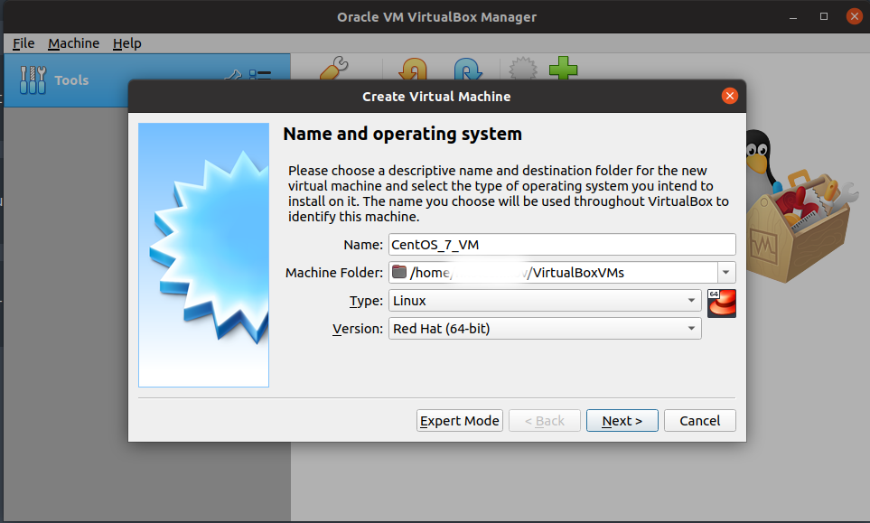
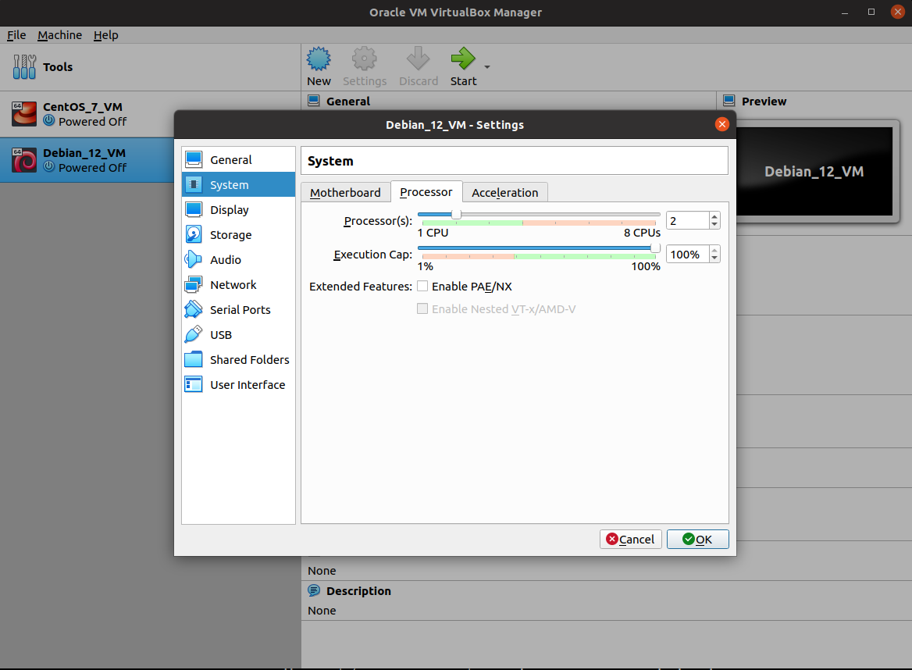
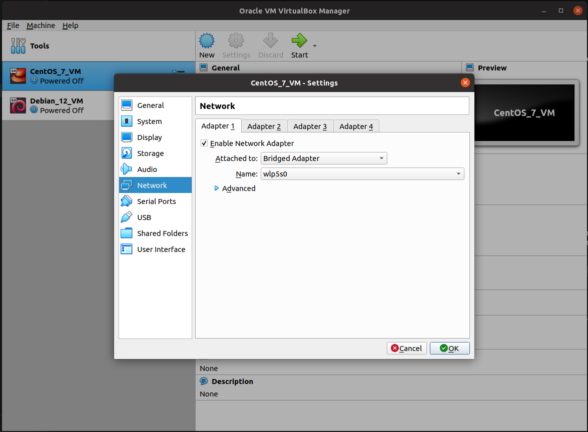
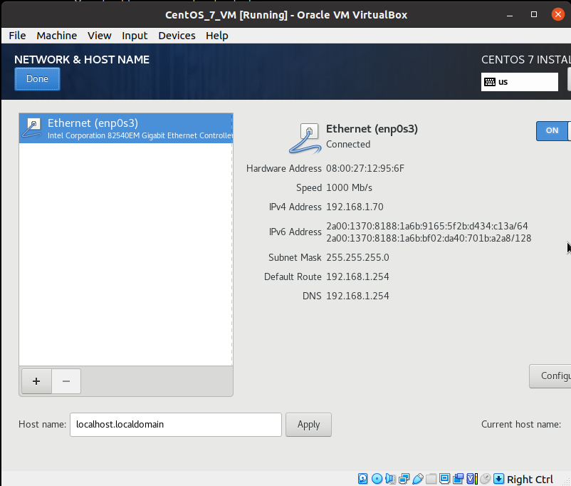
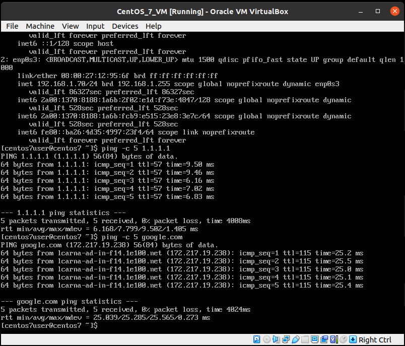
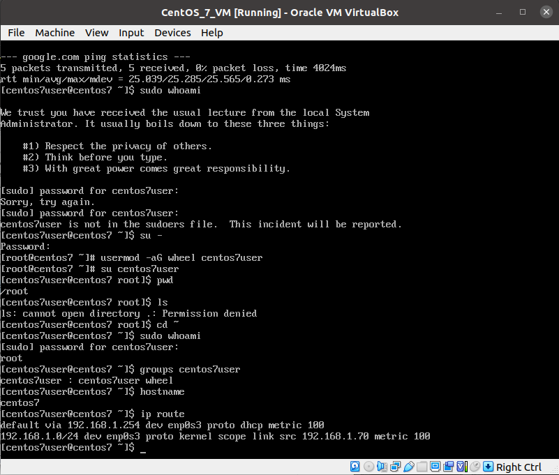
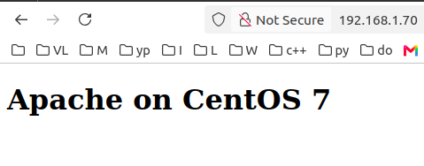
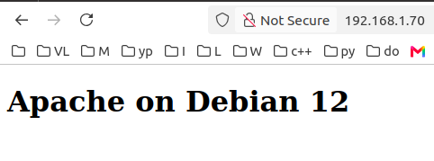
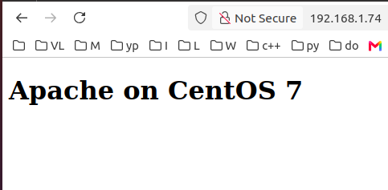
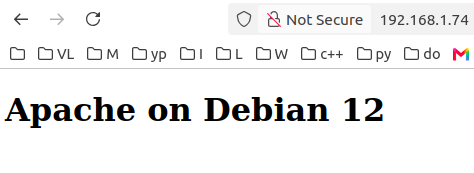

# Инструкция по настройке веб-серверов Apache и Nginx

## Постановка задачи

В результате выполнения работы по инструкции мы хотим получить следующую конфигурацию:

                 ┌───────────────┐
                 │ Debian Nginx  │
                 │      :80      │
                 └───────┬───────┘
                         │
                    ┌────┴────┐
                    ▼         ▼
             Debian Apache  CentOS Apache
                :8080          :8080
                    ▲         ▲
                    └────┬────┘
                         │
                 ┌───────┴───────┐
                 │ CentOS Nginx  │
                 │      :80      │
                 └───────────────┘

Apache и Nginx сервера запущены на 2х виртуальных машинах - Debian 12 и CentOS 7 соотвественно. Далее с хоста (Ubuntu) мы, обращаясь к nginx, получаем доступ к веб-страницам apache:

                Ubuntu host / browser
                   |            |
                   |            |
              Debian IP     CentOS IP
                   |            |
                   v            v
              Nginx :80     Nginx :80
              (frontend)    (frontend)
                   |            |
                   +-----+------+
                         |
                  Both Apache backends
                         |
             +-----------+-----------+
             |                       |
             v                       v
       Debian Apache           CentOS Apache
          :8080                    :8080

## Установка и настройка VirtualBox на Ubuntu

В качестве основной операционной системы (хоста) используется Ubuntu. В ней устанавливается **VirtualBox**, внутри которого создаются две виртуальные машины: Debian 12 и CentOS 7.

Установить VirtualBox можно из стандартных репозиториев Ubuntu с помощью пакетного менеджера APT:

```bash
sudo apt update
sudo apt install virtualbox
```

После установки проверить версию VirtualBox:

```bash
VBoxManage --version
```

Запустить графический интерфейс VirtualBox можно через меню приложений Ubuntu или из терминала:

```bash
virtualbox
```

После этого в VirtualBox можно создать две виртуальные машины:

```text
Ubuntu (хост)
    │
    └── VirtualBox
          │
          ├── Debian 12
          │     ├── Apache
          │     └── Nginx
          │
          └── CentOS 7
                ├── Apache
                └── Nginx
```

В данном случае Ubuntu является **хостовой системой**, а Debian 12 и CentOS 7 — **гостевыми операционными системами**.

## Создание виртуальных машин

Для Debian 12 выбираем Linux: Debian 64bit, для CentOS 7 - RedHat 64bit:



Далее выделяем:
 - 2GB RAM
 - 20GB HardDisk VDI (родной формат VirtualBox)

 После создания обеих машин можно в разделе System указать количество виртуальных процессоров (vCPU) - например, 2:
 


## Настройка сетевого адаптера

**Bridged Adapter** (сетевой мост) — это режим подключения виртуальной машины к сети, при котором её виртуальная сетевая карта напрямую связывается с физическим адаптером основного (хост) компьютера. Bridged Adapter позволяет виртуальной машине получить собственный IP в той же сети, что и физический компьютер. Указываем в поле **Name** имя реального сетевого интерфейса для доступа в Интернет - в данном случае wlp5s0:




## Первичный запуск и настройка виртуальных машин

После создания и настройки параметров обеих виртуальных машин запускаем их и устанавливаем соответствующие операционные системы: Debian 12 и CentOS 7.

Скачать образы установочных дисков:

CentOS-7-x86_64-DVD-2009.torrent
https://vault.centos.org/7.9.2009/isos/x86_64/

debian-12.15.0-amd64-DVD-1.iso.torrent
https://cdimage.debian.org/cdimage/archive/12.15.0/amd64/bt-dvd/

В настройках каждой VM (Settings -> Storage) выбираем образ и запускаем установку ОС. Настраиваем следующие параметры для CentOS 7:

 - TimeZone - Europe/Moscow

 - Включить сетевой адаптер (ON)



 - Hostname: centos7

 - Installation destination: Automatic partitioning

 - Software selection: Minimal Install

 - Root password (***)

 - username/password (centos7user/***) 

Для Debian12 примерно то же за исключением:

 - Hostname: debian12

 - username/password (debian12user/***) 


После установки проверим что работает сеть, DNS (CentOS 7):

```console
ip addr
ping -c 5 1.1.1.1
ping -c 5 google.com
```



и права суперпользователя для нашего юзера:

```console
sudo whoami
```
(root)


> Если забыли сделать пользователя администратором при установке, можно сделать это из консоли:
>
> ```console
> su -
> usermod -aG wheel centos7user
> su centos7user
> ```

Также стоит проверить:

```console
hostname
ip route
```



Теперь сделаем snapshot centos7-clean-install.

Аналогичный процесс проводим для Debian 12.

> DNS по умолчанию предлагал IPv6, который не был настроен для VM, поэтому явно указал IPv4 для проверки:
>
> ```console
> ping -4 -c 5 google.com
> ```

Делаем snapshot debian12-clean-install.

## Установка и настройка серверов на CentOS 7

CentOS 7 не может найти обновления по старому адресу:

```console
[centos7user@centos7 ~]$ sudo yum update
Loaded plugins: fastestmirror
Determining fastest mirrors
Could not retrieve mirrorlist http://mirrorlist.centos.org/?release=7&arch=x86_64&repo=os&infra=stock error was
14: curl#6 - "Could not resolve host: mirrorlist.centos.org; Unknown error"
```

CentOS 7 достигла окончания жизненного цикла (EOL) 30 июня 2024 года. После этой даты новые обновления для CentOS 7 не публикуются.
Архивные пакеты CentOS 7 были перенесены в CentOS Vault ([vault.centos.org](https://vault.centos.org/)), где они доступны как снимки репозиториев.

В /etc/yum.repos.d/ хранятся адреса репозиториев с пакетами - посмотрим на /etc/yum.repos.d/CentOS-Base.repo
(yum требуется, чтобы хотя бы в одном из файлов в /etc/yum.repos.d/ были указаны актуальные репозитории):

```console
[centos7user@centos7 ~]$ cat /etc/yum.repos.d/CentOS-Base.repo
# CentOS-Base.repo
#
# The mirror system uses the connecting IP address of the client and the
# update status of each mirror to pick mirrors that are updated to and
# geographically close to the client.  You should use this for CentOS updates
# unless you are manually picking other mirrors.
#
# If the mirrorlist= does not work for you, as a fall back you can try the 
# remarked out baseurl= line instead.
#
#

[base]
name=CentOS-$releasever - Base
mirrorlist=http://mirrorlist.centos.org/?release=$releasever&arch=$basearch&repo=os&infra=$infra
#baseurl=http://mirror.centos.org/centos/$releasever/os/$basearch/
gpgcheck=1
gpgkey=file:///etc/pki/rpm-gpg/RPM-GPG-KEY-CentOS-7

#released updates 
[updates]
name=CentOS-$releasever - Updates
mirrorlist=http://mirrorlist.centos.org/?release=$releasever&arch=$basearch&repo=updates&infra=$infra
#baseurl=http://mirror.centos.org/centos/$releasever/updates/$basearch/
gpgcheck=1
gpgkey=file:///etc/pki/rpm-gpg/RPM-GPG-KEY-CentOS-7

#additional packages that may be useful
[extras]
name=CentOS-$releasever - Extras
mirrorlist=http://mirrorlist.centos.org/?release=$releasever&arch=$basearch&repo=extras&infra=$infra
#baseurl=http://mirror.centos.org/centos/$releasever/extras/$basearch/
gpgcheck=1
gpgkey=file:///etc/pki/rpm-gpg/RPM-GPG-KEY-CentOS-7

#additional packages that extend functionality of existing packages
[centosplus]
name=CentOS-$releasever - Plus
mirrorlist=http://mirrorlist.centos.org/?release=$releasever&arch=$basearch&repo=centosplus&infra=$infra
#baseurl=http://mirror.centos.org/centos/$releasever/centosplus/$basearch/
gpgcheck=1
enabled=0
gpgkey=file:///etc/pki/rpm-gpg/RPM-GPG-KEY-CentOS-7
```

Сделаем backup старых настроек:

```console
sudo cp -a /etc/yum.repos.d/CentOS-Base.repo /etc/yum.repos.d/CentOS-Base.repo.backup
```

и заменяем старые адреса на новые для [base], [updates] и [extras],
используя baseurl вместо mirrorlist, как нам советует комментарий, например так:

```console
sudo tee /etc/yum.repos.d/CentOS-Base.repo > /dev/null <<'EOF'
[base]
name=CentOS-7.9.2009 - Base
baseurl=http://vault.centos.org/7.9.2009/os/$basearch/
enabled=1
gpgcheck=1
gpgkey=file:///etc/pki/rpm-gpg/RPM-GPG-KEY-CentOS-7

[updates]
name=CentOS-7.9.2009 - Updates
baseurl=http://vault.centos.org/7.9.2009/updates/$basearch/
enabled=1
gpgcheck=1
gpgkey=file:///etc/pki/rpm-gpg/RPM-GPG-KEY-CentOS-7

[extras]
name=CentOS-7.9.2009 - Extras
baseurl=http://vault.centos.org/7.9.2009/extras/$basearch/
enabled=1
gpgcheck=1
gpgkey=file:///etc/pki/rpm-gpg/RPM-GPG-KEY-CentOS-7
EOF
```

Далее очистим кэш:

```console
[centos7user@centos7 ~]$ sudo yum clean all
Loaded plugins: fastestmirror
Cleaning repos: base extras updates
Cleaning up list of fastest mirrors
```
чтобы создать его заново:

```console
[centos7user@centos7 ~]$ sudo yum makecache
...
(9/10): extras/x86_64/primary_db            | 253 kB  00:00:30 
(10/10): updates/x86_64/primary_db          |  27 MB  00:00:31     
Metadata Cache Created
```

и проверить что есть доступ к репозиториям

```console
[centos7user@centos7 ~]$ sudo yum repolist
repo id                 repo name                       status
!base/x86_64            CentOS-7.9.2009 - Base          10 072
!extras/x86_64          CentOS-7.9.2009 - Extras        526
!updates/x86_64         CentOS-7.9.2009 - Updates       6 173
repolist: 16 771
```

Далее, наконец-то, уcтановка пакетов:

```console
sudo yum update
```

и

```console
sudo yum install httpd nginx
```

чтобы обнаружить, что в добавленных архивных репозиториях нет nginx:

```console
No package nginx available.
...
[centos7user@centos7 ~]$ rpm -q httpd nginx
httpd-2.4.6-99.el7.centos.1.x86_64
package nginx is not installed
```

Тогда по инструкции с сайта nginx (https://nginx.org/en/linux_packages.html) добавим репозиторий для него:

```console
sudo tee /etc/yum.repos.d/nginx.repo >> /dev/null <<'EOF'
[nginx-stable]
name=nginx stable repo
baseurl=https://nginx.org/packages/centos/$releasever/$basearch/
gpgcheck=1
enabled=1
gpgkey=https://nginx.org/keys/nginx_signing.key
module_hotfixes=true
EOF
```

Затем снова:

```console
sudo yum install nginx
```

Теперь nginx установлен, проверим службы:

```console
[centos7user@centos7 ~]$ systemctl status httpd
● httpd.service - The Apache HTTP Server
   Loaded: loaded (/usr/lib/systemd/system/httpd.service; disabled; vendor preset: disabled)
   Active: inactive (dead)
     Docs: man:httpd(8)
           man:apachectl(8)
[centos7user@centos7 ~]$ systemctl status nginx
● nginx.service - nginx - high performance web server
   Loaded: loaded (/usr/lib/systemd/system/nginx.service; disabled; vendor preset: disabled)
   Active: inactive (dead)
     Docs: http://nginx.org/en/docs/

```

### Настройка Apache

Пока всё выключено, сначала настроим Apache-backend:

```console
[centos7user@centos7 ~]$ sudo grep -Rni "^Listen" /etc/httpd/conf/ /etc/httpd/conf.d/
/etc/httpd/conf/httpd.conf:42:Listen 80
```

Заменим 'Listen 80' на 'Listen 8080' в /etc/httpd/conf/httpd.conf.

У apache есть специальная утилита для проверки конфигов, запустим:

```console
sudo apachectl configtest
```

Мы хотим увидеть:

```console
Syntax OK
```

Теперь добавим службу apache в автозапуск и сразу запустим:

```console
sudo systemctl enable --now httpd
```

Она поднялаcь:

```console
[centos7user@centos7 ~]$ sudo systemctl status httpd
● httpd.service - The Apache HTTP Server
   Loaded: loaded (/usr/lib/systemd/system/httpd.service; enabled; vendor preset: disabled)
   Active: active (running) since Ср 2026-10-07 19:38:14 MSK; 17s ago
     Docs: man:httpd(8)
           man:apachectl(8)
 Main PID: 11258 (httpd)
   Status: "Total requests: 0; Current requests/sec: 0; Current traffic:   0 B/sec"
   CGroup: /system.slice/httpd.service
           ├─11258 /usr/sbin/httpd -DFOREGROUND
           ├─11259 /usr/sbin/httpd -DFOREGROUND
           ├─11260 /usr/sbin/httpd -DFOREGROUND
           ├─11261 /usr/sbin/httpd -DFOREGROUND
           ├─11262 /usr/sbin/httpd -DFOREGROUND
           └─11263 /usr/sbin/httpd -DFOREGROUND

окт 07 19:38:09 centos7 systemd[1]: Starting The Apache HTTP Server...
окт 07 19:38:14 centos7 httpd[11258]: AH00558: httpd: Could not reliably determine the server's fully qualified domain name, using fe80::ba26:4d35:4997:23f4. Set the 'ServerName' directive globally to suppress this message
окт 07 19:38:14 centos7 systemd[1]: Started The Apache HTTP Server.
```


Процесс (-p) httpd слушает (-l) TCP (-t) порт номер (-n) 8080: 

```console
[centos7user@centos7 ~]$ sudo ss -lntp | grep ':8080'
LISTEN     0      128       [::]:8080                  [::]:*                   users:(("httpd",pid=11263,fd=4),("httpd",pid=11262,fd=4),("httpd",pid=11261,fd=4),("httpd",pid=11260,fd=4),("httpd",pid=11259,fd=4),("httpd",pid=11258,fd=4))
```
(ss = socket statistics)

но при выполнении HEAD-запроса Apache вернул 403 Forbidden:

```console
[centos7user@centos7 ~]$ curl -I http://localhost:8080
HTTP/1.1 403 Forbidden
Date: Thu, 08 Oct 2026 12:25:06 GMT
Server: Apache/2.4.6 (CentOS)
Last-Modified: Thu, 16 Oct 2014 13:20:58 GMT
ETag: "1321-5058a1e728280"
Accept-Ranges: bytes
Content-Length: 4897
Content-Type: text/html; charset=UTF-8
```
в логах видно что не найден index.html в /var/www/html/:

```console
[centos7user@centos7 ~]$ sudo tail -20 /var/log/httpd/error_log
[Wed Oct 07 19:38:14.388388 2026] [core:notice] [pid 11258] SELinux policy enabled; httpd running as context system_u:system_r:httpd_t:s0
[Wed Oct 07 19:38:14.394485 2026] [suexec:notice] [pid 11258] AH01232: suEXEC mechanism enabled (wrapper: /usr/sbin/suexec)
AH00558: httpd: Could not reliably determine the server's fully qualified domain name, using fe80::ba26:4d35:4997:23f4. Set the 'ServerName' directive globally to suppress this message
[Wed Oct 07 19:38:14.431336 2026] [lbmethod_heartbeat:notice] [pid 11258] AH02282: No slotmem from mod_heartmonitor
[Wed Oct 07 19:38:14.435755 2026] [mpm_prefork:notice] [pid 11258] AH00163: Apache/2.4.6 (CentOS) configured -- resuming normal operations
[Wed Oct 07 19:38:14.435802 2026] [core:notice] [pid 11258] AH00094: Command line: '/usr/sbin/httpd -D FOREGROUND'
[Wed Oct 07 19:52:28.245173 2026] [autoindex:error] [pid 11259] [client ::1:52100] AH01276: Cannot serve directory /var/www/html/: No matching DirectoryIndex (index.html) found, and server-generated directory index forbidden by Options directive
[Wed Oct 07 20:05:44.860071 2026] [autoindex:error] [pid 11262] [client ::1:52102] AH01276: Cannot serve directory /var/www/html/: No matching DirectoryIndex (index.html) found, and server-generated directory index forbidden by Options directive
[Thu Oct 08 15:25:06.953177 2026] [autoindex:error] [pid 11260] [client ::1:52104] AH01276: Cannot serve directory /var/www/html/: No matching DirectoryIndex (index.html) found, and server-generated directory index forbidden by Options directive
```

создадим простой тестовый html:

```console
sudo vi /var/www/html/index.html
```

следующего содержания:

```console
<!DOCTYPE html>
<html>
<head>
    <title>CentOS Apache</title>
</head>
<body>
    <h1>Apache on CentOS 7</h1>
</body>
</html>
```

и теперь он доступен:

```console
[centos7user@centos7 ~]$ curl http://localhost:8080
<!DOCTYPE html>
<html>
<head>
    <title>CentOS Apache</title>
</head>
<body>
    <h1>Apache on CentOS 7</h1>
</body>
</html>
```

### Настройка Nginx

Добавим Nginx в автозагрузку и проверим что сервис запущен:
```console
[centos7user@centos7 ~]$ sudo systemctl enable --now nginx
Created symlink from /etc/systemd/system/multi-user.target.wants/nginx.service to /usr/lib/systemd/system/nginx.service.
[centos7user@centos7 ~]$ sudo systemctl status nginx
● nginx.service - nginx - high performance web server
   Loaded: loaded (/usr/lib/systemd/system/nginx.service; enabled; vendor preset: disabled)
   Active: active (running) since Вс 2026-10-18 21:45:05 MSK; 4min 9s ago
     Docs: http://nginx.org/en/docs/
  Process: 11754 ExecStart=/usr/sbin/nginx -c /etc/nginx/nginx.conf (code=exited, status=0/SUCCESS)
 Main PID: 11755 (nginx)
   CGroup: /system.slice/nginx.service
           ├─11755 nginx: master process /usr/sbin/nginx -c /etc/nginx/nginx.conf
           ├─11756 nginx: worker process
           └─11757 nginx: worker process

окт 18 21:45:05 centos7 systemd[1]: Starting nginx - high performance web server...
окт 18 21:45:05 centos7 systemd[1]: Started nginx - high performance web server.

```

Убедимся что сервисы слушают нужные порты:
```console
[centos7user@centos7 ~]$ sudo ss -lntp | grep -E ':80|:8080'
LISTEN     0      128          *:80                       *:*                   users:(("nginx",pid=11757,fd=6),("nginx",pid=11756,fd=6),("nginx",pid=11755,fd=6))
LISTEN     0      128       [::]:8080                  [::]:*                   users:(("httpd",pid=12250,fd=4),("httpd",pid=12249,fd=4),("httpd",pid=12248,fd=4),("httpd",pid=12247,fd=4),("httpd",pid=12246,fd=4),("httpd",pid=11258,fd=4))
```

Добавим конфиг для взаимодействия с apache:
```console
sudo vi /etc/nginx/conf.d/apache.conf
```
следующего содержания:
```console
server {
    listen 80;
    server_name _;

    location / {
        proxy_pass http://127.0.0.1:8080;
        proxy_set_header Host $host;
        proxy_set_header X-Real-IP $remote_addr;
        proxy_set_header X-Forwarded-For $proxy_add_x_forwarded_for;
        proxy_set_header X-Forwarded-Proto $scheme;
    }
}
```
т.е. запросы с сервера слушающего 80й порт перенаправляются на http://127.0.0.1:8080 и заполняется заголовок пересланного запроса:
 - Host - IP хоста (запрошенный клиентом $host);
 - X-Real-IP - IP клиента ($remote_addr);
 - X-Forwarded-For - список IP прокси, через которые запрос прошёл ($proxy_add_x_forwarded_for добавляет $remote_addr к входящему X-Forwarded-For списку, изначально пустому);
 - X-Forwarded-Proto - протокол, по которому клиент подсоединялся к nginx-прокси ($scheme).

 Проверим правильность конфигурации nginx:
```console
[centos7user@centos7 ~]$ sudo nginx -t
nginx: the configuration file /etc/nginx/nginx.conf syntax is ok
nginx: configuration file /etc/nginx/nginx.conf test is successful
```

перезагрузим
```console
sudo systemctl reload nginx
```

обнаружим, что коннект идёт к apache напрямую, но не через nginx (502 Bad Gateway):
```console
[centos7user@centos7 ~]$ curl http://127.0.0.1:8080
<!DOCTYPE html>
<html>
<head>
    <title>CentOS Apache</title>
</head>
<body>
    <h1>Apache on CentOS 7</h1>
</body>
</html>
[centos7user@centos7 ~]$ curl http://127.0.0.1:80
<html>
<head><title>502 Bad Gateway</title></head>
<body>
<center><h1>502 Bad Gateway</h1></center>
<hr><center>nginx/1.26.1</center>
</body>
</html>
```

Посмотрим логи nginx:
```console
[centos7user@centos7 ~]$ sudo tail -20 /var/log/nginx/error.log
2026/10/19 10:22:40 [notice] 11755#11755: signal 1 (SIGHUP) received from 12502, reconfiguring
2026/10/19 10:22:40 [notice] 11755#11755: reconfiguring
2026/10/19 10:22:40 [notice] 11755#11755: using the "epoll" event method
2026/10/19 10:22:40 [notice] 11755#11755: start worker processes
2026/10/19 10:22:40 [notice] 11755#11755: start worker process 12506
2026/10/19 10:22:40 [notice] 11755#11755: start worker process 12507
2026/10/19 10:22:40 [notice] 11756#11756: gracefully shutting down
2026/10/19 10:22:40 [notice] 11756#11756: exiting
2026/10/19 10:22:40 [notice] 11756#11756: exit
2026/10/19 10:22:40 [notice] 11757#11757: gracefully shutting down
2026/10/19 10:22:40 [notice] 11757#11757: exiting
2026/10/19 10:22:40 [notice] 11757#11757: exit
2026/10/19 10:22:40 [notice] 11755#11755: signal 17 (SIGCHLD) received from 11757
2026/10/19 10:22:40 [notice] 11755#11755: worker process 11757 exited with code 0
2026/10/19 10:22:40 [notice] 11755#11755: signal 29 (SIGIO) received
2026/10/19 10:22:40 [notice] 11755#11755: signal 17 (SIGCHLD) received from 11756
2026/10/19 10:22:40 [notice] 11755#11755: worker process 11756 exited with code 0
2026/10/19 10:22:40 [notice] 11755#11755: signal 29 (SIGIO) received
2026/10/19 10:25:20 [crit] 12507#12507: *1 connect() to 127.0.0.1:8080 failed (13: Permission denied) while connecting to upstream, client: 127.0.0.1, server: _, request: "GET / HTTP/1.1", upstream: "http://127.0.0.1:8080/", host: "127.0.0.1"
2026/10/19 10:25:30 [crit] 12507#12507: *3 connect() to 127.0.0.1:8080 failed (13: Permission denied) while connecting to upstream, client: 127.0.0.1, server: _, request: "GET / HTTP/1.1", upstream: "http://127.0.0.1:8080/", host: "127.0.0.1"
```
проверим SELinux - включен:
```console
[centos7user@centos7 ~]$ getenforce
Enforcing
```
https://docs.redhat.com/en/documentation/red_hat_enterprise_linux/7/html/selinux_users_and_administrators_guide/sect-managing_confined_services-the_apache_http_server-booleans
> httpd_can_network_connect
>
>     When disabled, this Boolean prevents HTTP scripts and modules from initiating a connection to a network or remote port. Enable this > Boolean to allow this access. 

```console
[centos7user@centos7 ~]$ getsebool httpd_can_network_connect
httpd_can_network_connect --> off
```
в системных логах AVC (Access Vector Cache) есть записи о запрете доступа для **comm="nginx"**:
```console
[centos7user@centos7 ~]$ sudo ausearch -m AVC -ts recent
----
time->Mon Oct 19 10:25:20 2026
type=PROCTITLE msg=audit(1792394720.976:7578): proctitle=6E67696E783A20776F726B65722070726F63657373
type=SYSCALL msg=audit(1792394720.976:7578): arch=c000003e syscall=42 success=no exit=-13 a0=7 a1=55708b2f8910 a2=10 a3=7fff9c8f0160 items=0 ppid=11755 pid=12507 auid=4294967295 uid=998 gid=996 euid=998 suid=998 fsuid=998 egid=996 sgid=996 fsgid=996 tty=(none) ses=4294967295 comm="nginx" exe="/usr/sbin/nginx" subj=system_u:system_r:httpd_t:s0 key=(null)
type=AVC msg=audit(1792394720.976:7578): avc:  denied  { name_connect } for  pid=12507 comm="nginx" dest=8080 scontext=system_u:system_r:httpd_t:s0 tcontext=system_u:object_r:http_cache_port_t:s0 tclass=tcp_socket permissive=0
----
time->Mon Oct 19 10:25:30 2026
type=PROCTITLE msg=audit(1792394730.008:7579): proctitle=6E67696E783A20776F726B65722070726F63657373
type=SYSCALL msg=audit(1792394730.008:7579): arch=c000003e syscall=42 success=no exit=-13 a0=7 a1=55708b2f8910 a2=10 a3=7fff9c8f0160 items=0 ppid=11755 pid=12507 auid=4294967295 uid=998 gid=996 euid=998 suid=998 fsuid=998 egid=996 sgid=996 fsgid=996 tty=(none) ses=4294967295 comm="nginx" exe="/usr/sbin/nginx" subj=system_u:system_r:httpd_t:s0 key=(null)
type=AVC msg=audit(1792394730.008:7579): avc:  denied  { name_connect } for  pid=12507 comm="nginx" dest=8080 scontext=system_u:system_r:httpd_t:s0 tcontext=system_u:object_r:http_cache_port_t:s0 tclass=tcp_socket permissive=0
```

Включим httpd_can_network_connect (-P (persistent) означает сохранять опцию поле перезагрузки):
```console
[centos7user@centos7 ~]$ sudo setsebool -P httpd_can_network_connect 1
[centos7user@centos7 ~]$ getsebool httpd_can_network_connect
httpd_can_network_connect --> on
```

и теперь соединение через nginx проходит:
[centos7user@centos7 ~]$ curl http://127.0.0.1
```console
<!DOCTYPE html>
<html>
<head>
    <title>CentOS Apache</title>
</head>
<body>
    <h1>Apache on CentOS 7</h1>
</body>
</html>
```
(порт :80 можно не указывать как дефолтный для http)

Но снаружи (с Ubuntu-host) соединение всё равно не проходит:
```console
~$ curl -v --connect-timeout 5 http://192.168.1.70
*   Trying 192.168.1.70:80...
* TCP_NODELAY set
* connect to 192.168.1.70 port 80 failed: No route to host
* Failed to connect to 192.168.1.70 port 80: No route to host
* Closing connection 0
curl: (7) Failed to connect to 192.168.1.70 port 80: No route to host
```
из-за firewall:
```console
[centos7user@centos7 ~]$ sudo systemctl status firewalld
● firewalld.service - firewalld - dynamic firewall daemon
   Loaded: loaded (/usr/lib/systemd/system/firewalld.service; enabled; vendor preset: enabled)
   Active: active (running) since Вт 2026-10-06 23:49:29 MSK; 1 weeks 5 days ago
     Docs: man:firewalld(1)
 Main PID: 23795 (firewalld)
   CGroup: /system.slice/firewalld.service
           └─23795 /usr/bin/python2 -Es /usr/sbin/firewalld --nofork --nopid

окт 06 23:49:28 centos7 systemd[1]: Stopped firewalld - dynamic firewall daemon.
окт 06 23:49:28 centos7 systemd[1]: Starting firewalld - dynamic firewall daemon...
окт 06 23:49:29 centos7 systemd[1]: Started firewalld - dynamic firewall daemon.
окт 06 23:49:29 centos7 firewalld[23795]: WARNING: AllowZoneDrifting is enabled. This is considered an insecure configuration option. It will be removed in a future release. Please consider disabling it now.
[centos7user@centos7 ~]$ sudo firewall-cmd --list-all
public (active)
  target: default
  icmp-block-inversion: no
  interfaces: enp0s3
  sources: 
  services: dhcpv6-client ssh
  ports: 
  protocols: 
  masquerade: no
  forward-ports: 
  source-ports: 
  icmp-blocks: 
  rich rules: 
```
который разрешает подключение например по ssh, но не http, исправим это:
```console
[centos7user@centos7 ~]$ sudo firewall-cmd --zone=public --add-service=http --permanent
success
[centos7user@centos7 ~]$ sudo firewall-cmd --reload
success
[centos7user@centos7 ~]$ sudo firewall-cmd --zone=public --list-all
public (active)
  target: default
  icmp-block-inversion: no
  interfaces: enp0s3
  sources: 
  services: dhcpv6-client http ssh
  ports: 
  protocols: 
  masquerade: no
  forward-ports: 
  source-ports: 
  icmp-blocks: 
  rich rules: 
```
Теперь снаружи страница видна через nginx:
```console
~$ curl http://192.168.1.70
<!DOCTYPE html>
<html>
<head>
    <title>CentOS Apache</title>
</head>
<body>
    <h1>Apache on CentOS 7</h1>
</body>
</html>
```

Связка Apache+Nginx на CentOS 7 настроена.

## Установка и настройка серверов на Debian 12
```console
su -
usermod -aG sudo debian12user
su debian12user
```

```console
debian12user@debian12:~$ groups debian12user
debian12user : debian12user cdrom floppy sudo audio dip video plugdev users netdev bluetooth lpadmin scanner
debian12user@debian12:~$ sudo whoami
root
```


> Debian'у мешал устанавливать пакеты образ установочного диска в /etc/apt/sources.list, пришлось его закомментировать:
>
> nano /etc/apt/sources.list
>
> \# deb cdrom:[Debian GNU/Linux 12.15.0 _Bookworm_ - Official amd64 DVD Binary-1 with firmware 20260711-14:03]/ bookworm contrib main non-free-firmware
>

```console
sudo apt update
sudo apt upgrade
```

```console
debian12user@debian12:~$ ip -4 addr
1: lo: <LOOPBACK,UP,LOWER_UP> mtu 65536 qdisc noqueue state UNKNOWN group default qlen 1000
    inet 127.0.0.1/8 scope host lo
       valid_lft forever preferred_lft forever
2: enp0s3: <BROADCAST,MULTICAST,UP,LOWER_UP> mtu 1500 qdisc fq_codel state UP group default qlen 1000
    inet 192.168.1.74/24 brd 192.168.1.255 scope global dynamic noprefixroute enp0s3
       valid_lft 28438sec preferred_lft 28438sec
```

Ubuntu:
```console
ssh-copy-id -i ~/.ssh/id_ed25519.pub debian12user@192.168.1.74
ssh debian12user@192.168.1.74
```

```console
sudo apt install apache2
```

```console
debian12user@debian12:~$ grep -R '^Listen'  /etc/apache2/
/etc/apache2/ports.conf:Listen 80
```

Меняем на 8080.

```console
\# If you just change the port or add more ports here, you will likely also
\# have to change the VirtualHost statement in
\# /etc/apache2/sites-enabled/000-default.conf
```

```console                                                                        
<VirtualHost *:8080>
        # The ServerName directive sets the request scheme, hostname and port that
        # the server uses to identify itself. This is used when creating
        # redirection URLs. In the context of virtual hosts, the ServerName
        # specifies what hostname must appear in the request's Host: header to
        # match this virtual host. For the default virtual host (this file) this
        # value is not decisive as it is used as a last resort host regardless.
        # However, you must set it for any further virtual host explicitly.
        #ServerName www.example.com

        ServerAdmin webmaster@localhost
        DocumentRoot /var/www/html

        # Available loglevels: trace8, ..., trace1, debug, info, notice, warn,
        # error, crit, alert, emerg.
        # It is also possible to configure the loglevel for particular
        # modules, e.g.
        #LogLevel info ssl:warn

        ErrorLog ${APACHE_LOG_DIR}/error.log
        CustomLog ${APACHE_LOG_DIR}/access.log combined

        # For most configuration files from conf-available/, which are
        # enabled or disabled at a global level, it is possible to
        # include a line for only one particular virtual host. For example the
        # following line enables the CGI configuration for this host only
        # after it has been globally disabled with "a2disconf".
        #Include conf-available/serve-cgi-bin.conf
</VirtualHost>
```

Строго говоря это не необходимо в данном случае


```console
debian12user@debian12:~$ sudo apache2ctl configtest
AH00558: apache2: Could not reliably determine the server's fully qualified domain name, using 127.0.1.1. Set the 'ServerName' directive globally to suppress this message
Syntax OK
```

```console
sudo nano /etc/apache2/apache2.conf
ServerName debian12apache
```

```console
debian12user@debian12:~$ sudo apache2ctl -S
VirtualHost configuration:
*:8080                 debian12apache (/etc/apache2/sites-enabled/000-default.conf:1)
ServerRoot: "/etc/apache2"
Main DocumentRoot: "/var/www/html"
Main ErrorLog: "/var/log/apache2/error.log"
Mutex watchdog-callback: using_defaults
Mutex default: dir="/var/run/apache2/" mechanism=default 
PidFile: "/var/run/apache2/apache2.pid"
Define: DUMP_VHOSTS
Define: DUMP_RUN_CFG
User: name="www-data" id=33
Group: name="www-data" id=33
```

```console
debian12user@debian12:~$ sudo systemctl restart apache2
debian12user@debian12:~$ sudo systemctl status apache2
● apache2.service - The Apache HTTP Server
     Loaded: loaded (/lib/systemd/system/apache2.service; enabled; preset: enabled)
     Active: active (running) since Sat 2026-10-24 12:42:35 EDT; 9s ago
       Docs: https://httpd.apache.org/docs/2.4/
    Process: 34378 ExecStart=/usr/sbin/apachectl start (code=exited, status=0/SUCCESS)
   Main PID: 34383 (apache2)
      Tasks: 55 (limit: 2276)
     Memory: 16.8M
        CPU: 61ms
     CGroup: /system.slice/apache2.service
             ├─34383 /usr/sbin/apache2 -k start
             ├─34384 /usr/sbin/apache2 -k start
             └─34385 /usr/sbin/apache2 -k start

Oct 24 12:42:35 debian12 systemd[1]: Starting apache2.service - The Apache HTTP Server...
Oct 24 12:42:35 debian12 systemd[1]: Started apache2.service - The Apache HTTP Server.
debian12user@debian12:~$ ss -lntp | grep ':8080'
LISTEN 0      511                *:8080            *:* 
debian12user@debian12:~$ curl -I http://127.0.0.1:8080
HTTP/1.1 200 OK
Date: Sat, 24 Oct 2026 16:44:25 GMT
Server: Apache/2.4.68 (Debian)
Last-Modified: Fri, 23 Oct 2026 09:44:57 GMT
ETag: "29cd-65e7ed54ba116"
Accept-Ranges: bytes
Content-Length: 10701
Vary: Accept-Encoding
Content-Type: text/html
```

Ubuntu:

```console
~$ curl -I http://192.168.1.74:8080
HTTP/1.1 200 OK
Date: Sat, 24 Oct 2026 16:46:04 GMT
Server: Apache/2.4.68 (Debian)
Last-Modified: Fri, 23 Oct 2026 09:44:57 GMT
ETag: "29cd-65e7ed54ba116"
Accept-Ranges: bytes
Content-Length: 10701
Vary: Accept-Encoding
Content-Type: text/html
```

Далее установим nginx:

```console
sudo apt install nginx

sudo systemctl enable nginx --now
```

проверим:
```console
debian12user@debian12:~$ sudo ss -lntp | grep -E ':(8080|80)\b'
LISTEN 0      511          0.0.0.0:80        0.0.0.0:*    users:(("nginx",pid=34707,fd=5),("nginx",pid=34706,fd=5),("nginx",pid=34704,fd=5))      
LISTEN 0      511                *:8080            *:*    users:(("apache2",pid=34385,fd=4),("apache2",pid=34384,fd=4),("apache2",pid=34383,fd=4))
LISTEN 0      511             [::]:80           [::]:*    users:(("nginx",pid=34707,fd=6),("nginx",pid=34706,fd=6),("nginx",pid=34704,fd=6))      

debian12user@debian12:~$ sudo systemctl status nginx
● nginx.service - A high performance web server and a reverse proxy server
     Loaded: loaded (/lib/systemd/system/nginx.service; enabled; preset: enabled)
     Active: active (running) since Sat 2026-10-24 13:01:23 EDT; 8min ago
       Docs: man:nginx(8)
   Main PID: 34704 (nginx)
      Tasks: 3 (limit: 2276)
     Memory: 2.4M
        CPU: 58ms
     CGroup: /system.slice/nginx.service
             ├─34704 "nginx: master process /usr/sbin/nginx -g daemon on; master_process on;"
             ├─34706 "nginx: worker process"
             └─34707 "nginx: worker process"

Oct 24 13:01:23 debian12 systemd[1]: Starting nginx.service - A high performance web server and a reverse proxy server...
Oct 24 13:01:23 debian12 systemd[1]: Started nginx.service - A high performance web server and a reverse proxy server.

debian12user@debian12:~$ systemctl is-enabled nginx
enabled
```

Перед настройкой nginx проверим прямую связь двух apache:
```console
[centos7user@centos7 ~]$ curl -I --connect-timeout 5 http://192.168.1.74:8080
HTTP/1.1 200 OK
Date: Sat, 24 Oct 2026 17:17:04 GMT
Server: Apache/2.4.68 (Debian)
Last-Modified: Fri, 23 Oct 2026 09:44:57 GMT
ETag: "29cd-65e7ed54ba116"
Accept-Ranges: bytes
Content-Length: 10701
Vary: Accept-Encoding
Content-Type: text/html

debian12user@debian12:~$ curl -I --connect-timeout 5 http://192.168.1.70:8080
curl: (7) Failed to connect to 192.168.1.70 port 8080 after 2 ms: Couldn't connect to server
```

Мешает firewall:
```console
[centos7user@centos7 ~]$ sudo firewall-cmd --state
running
[centos7user@centos7 ~]$ sudo firewall-cmd --query-port=8080/tcp
no
```

Откроем порт 8080 для TCP:
```console
[centos7user@centos7 ~]$ sudo firewall-cmd --permanent --add-port=8080/tcp
success
[centos7user@centos7 ~]$ sudo firewall-cmd --reload
success
```

И проверим:
```console
debian12user@debian12:~$ curl -I --connect-timeout 5 http://192.168.1.70:8080
HTTP/1.1 200 OK
Date: Sat, 24 Oct 2026 12:36:25 GMT
Server: Apache/2.4.6 (CentOS)
Last-Modified: Thu, 08 Oct 2026 13:03:20 GMT
ETag: "7e-65d53db29ee78"
Accept-Ranges: bytes
Content-Length: 126
Content-Type: text/html; charset=UTF-8
```

Сохраним оригинальные настройки nginx:
```console
sudo cp /etc/nginx/sites-available/default /etc/nginx/sites-available/default.backup
```

По аналогии с nginx на CentOS 7 настроим nginx на Debian12:
```console
upstream apache_backends {
    server 192.168.1.74:8080;
    server 192.168.1.70:8080;
}

server {
    listen 80 default_server;
    listen [::]:80 default_server;

    server_name _;

    location / {
        proxy_pass http://apache_backends;

        proxy_set_header Host $host;
        proxy_set_header X-Real-IP $remote_addr;
        proxy_set_header X-Forwarded-For $proxy_add_x_forwarded_for;
        proxy_set_header X-Forwarded-Proto $scheme;
    }
}
```

Проверим кофигурацию/перезагрузим кофигурацию/проверим статус:
```console
debian12user@debian12:~$ sudo nginx -t
nginx: the configuration file /etc/nginx/nginx.conf syntax is ok
nginx: configuration file /etc/nginx/nginx.conf test is successful

sudo systemctl reload nginx
sudo systemctl status nginx
```

Проверим доступ напрямую к обоим апачам:
```console
curl http://192.168.1.74:8080/
curl http://192.168.1.70:8080/
```

И балансировку через nginx (80й порт по умолчанию для http):
```console
for i in {1..6}; do
    curl -s http://192.168.1.74/
    echo
done
```

В консоли появляются странички apache то с CentOS, то с Debian. 


> Было дело: Debian потерял свой IPv4 адрес на интерфейсе enp0s3. Остался только IPv6, и SSH к 192.168.1.74 не подключался с No route to > host.
> 
> Реение: Напрямую попросить новый IPv4 адрес у DHCP сервера:
>
> sudo dhclient -4 -v enp0s3
>


## Финальная настройка

Осталось настроить балансировку на CentOS 7. Сохраним оригинальные насторйки:

```console
[centos7user@centos7 ~]$ sudo ls -l /etc/nginx/conf.d/
total 8
-rw-r--r--. 1 root root  318 окт 19 09:31 apache.conf
-rw-r--r--. 1 root root 1072 май 29  2024 default.conf

sudo cp -a /etc/nginx/conf.d/apache.conf /etc/nginx/conf.d/apache.conf.backup
sudo cp -a /etc/nginx/conf.d/default.conf /etc/nginx/conf.d/default.conf.backup
```

> cp -a - удобный способ делать бэкапы файлов (сохраняет права и т.п.)

sudo mv /etc/nginx/conf.d/default.conf /etc/nginx/conf.d/default.conf.disabled

> по умолчанию читаются конфиги *.conf - поэтому добавление .disabled к имени конфиг отключит


Поменяем аналогичным образом конфиг для nginx /etc/nginx/conf.d/apache.conf для распределния запросов на оба apache:
```console
upstream apache_backends {
    server 192.168.1.74:8080;
    server 192.168.1.70:8080;
}

server {
    listen 80 default_server;
    server_name _;

    location / {
        proxy_pass http://apache_backends;

        proxy_set_header Host $host;
        proxy_set_header X-Real-IP $remote_addr;
        proxy_set_header X-Forwarded-For $proxy_add_x_forwarded_for;
        proxy_set_header X-Forwarded-Proto $scheme;
    }
}
```

После как обычно проверка конфигурации, перезагрузка её же без прерывания работы сервиса(reload) и проверка статуса: 
```console
[centos7user@centos7 ~]$ sudo nginx -t
nginx: the configuration file /etc/nginx/nginx.conf syntax is ok
nginx: configuration file /etc/nginx/nginx.conf test is successful
[centos7user@centos7 ~]$ sudo systemctl reload nginx
[centos7user@centos7 ~]$ sudo systemctl status nginx
● nginx.service - nginx - high performance web server
   Loaded: loaded (/usr/lib/systemd/system/nginx.service; enabled; vendor preset: disabled)
   Active: active (running) since Ср 2026-10-28 22:42:40 MSK; 3min 19s ago
     Docs: http://nginx.org/en/docs/
  Process: 10139 ExecStop=/bin/sh -c /bin/kill -s TERM $(/bin/cat /var/run/nginx.pid) (code=exited, status=0/SUCCESS)
  Process: 10175 ExecReload=/bin/sh -c /bin/kill -s HUP $(/bin/cat /var/run/nginx.pid) (code=exited, status=0/SUCCESS)
  Process: 10144 ExecStart=/usr/sbin/nginx -c /etc/nginx/nginx.conf (code=exited, status=0/SUCCESS)
 Main PID: 10145 (nginx)
   CGroup: /system.slice/nginx.service
           ├─10145 nginx: master process /usr/sbin/nginx -c /etc/nginx/nginx.conf
           ├─10178 nginx: worker process
           └─10179 nginx: worker process

окт 28 22:42:40 centos7 systemd[1]: Stopped nginx - high performance web server.
окт 28 22:42:40 centos7 systemd[1]: Starting nginx - high performance web server...
окт 28 22:42:40 centos7 systemd[1]: Started nginx - high performance web server.
окт 28 22:45:56 centos7 systemd[1]: Reloading nginx - high performance web server.
окт 28 22:45:56 centos7 systemd[1]: Reloaded nginx - high performance web server.
```

На обеих вирутальнчх машинах:
```console
for i in {1..10}; do
    curl -s http://127.0.0.1/
    echo
done
```
показыает попеременно странички с CentOS и Debian (но необязательно строго чередуя).

C Ubuntu-хоста в браузере перезагружая страницу видим тот же результат:

CentOS_nginx_CentOS_apache:



CentOS_nginx_Debian_apache:



Debian_nginx_CentOS_apache:



Debian_nginx_Debian_apache:

